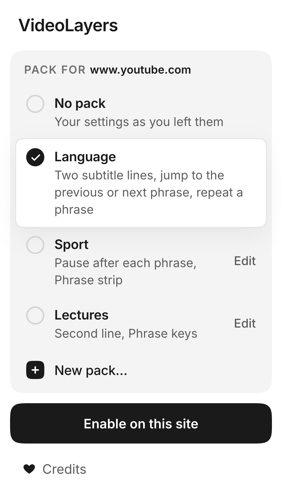
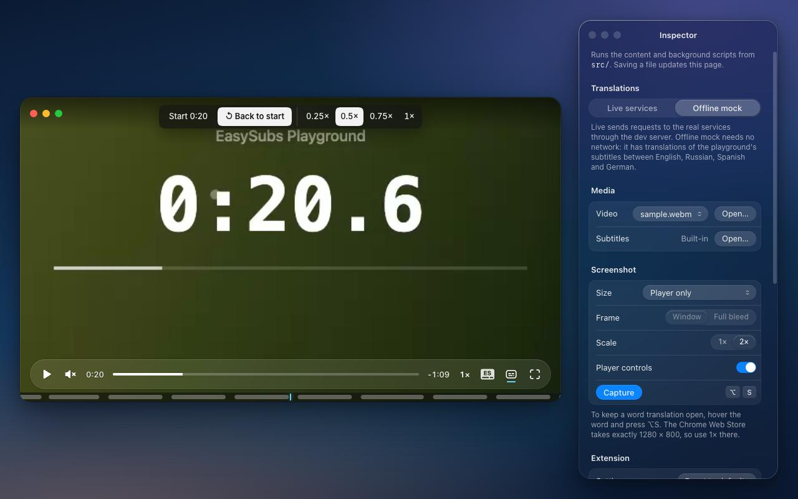

# VideoLayers

**Your video player, your way.** A free, open-source Chrome extension: on a video you pick a **pack**, a set of
features for what you're watching it for. Use a ready one, or put together your own.

  
  &nbsp;
  

## Packs

| Pack | What it does |
|---|---|
| **Language** | Two subtitle lines (the original and your language), jump to the previous or next phrase with ← →, repeat a phrase with ↓ |
| **Sport** | A bar over the video: mark where an exercise starts, jump back to it, slow down to 0.25× |
| **Your own** | **New pack…** in the window: name it, tick the features, change or delete it any time |

A pack is picked per site: one on YouTube, another on a course site, none somewhere else.

Features a pack can switch: second line, phrase keys, pause after each phrase, phrase strip, the site's captions,
exercise controls.

## Install

1. Download `videolayers.zip` from the [latest release](https://github.com/helenast88/videolayers/releases/latest)
   and unzip it.
2. Open `chrome://extensions`, turn on **Developer mode** and click **Load unpacked**. Pick the unzipped folder.
3. Open a video, click the VideoLayers icon and pick a pack.

It runs on YouTube, Netflix, Coursera and a few more; on another site click **Enable on this site** in the
window.

Or build it yourself: Node 20+, then `npx pnpm@10 install` and `npx pnpm@10 build`; the extension is in `dist/`.

## Next

- Gesture control for Sport: pause, back to start, slow down with your hand, through the camera, all on your
  computer
- Reader mode: a video turned into a page of text, the phrase being said lit up
- Voice commands
- Your own player skins on any site, so the skins people made for the Video.js challenge can live on every video
  they watch

## Contribute

Ideas for packs and skins, bugs, pull requests: all welcome. See [CONTRIBUTING.md](CONTRIBUTING.md).

## Credits

- [EasySubs](https://github.com/Nitrino/easysubs) by Nitrino and contributors (MIT): subtitles, the second line,
  translation and phrase navigation. VideoLayers is a fork of it; its README is in
  [docs/EASYSUBS-README.md](docs/EASYSUBS-README.md).
- [Chrome extension boilerplate](https://github.com/Jonghakseo/chrome-extension-boilerplate-react-vite) by
  Seo Jong Hak (MIT): the build setup, through EasySubs.
- The [Video.js Skins Design Challenge](https://contra.com/community/topic/videojsskinschallenge) on Contra, by
  Video.js and Mux: where the idea of a player for every use case came from.
- [Inter](https://rsms.me/inter/) by Rasmus Andersson (OFL-1.1).

## License

MIT, see [LICENSE](LICENSE).
